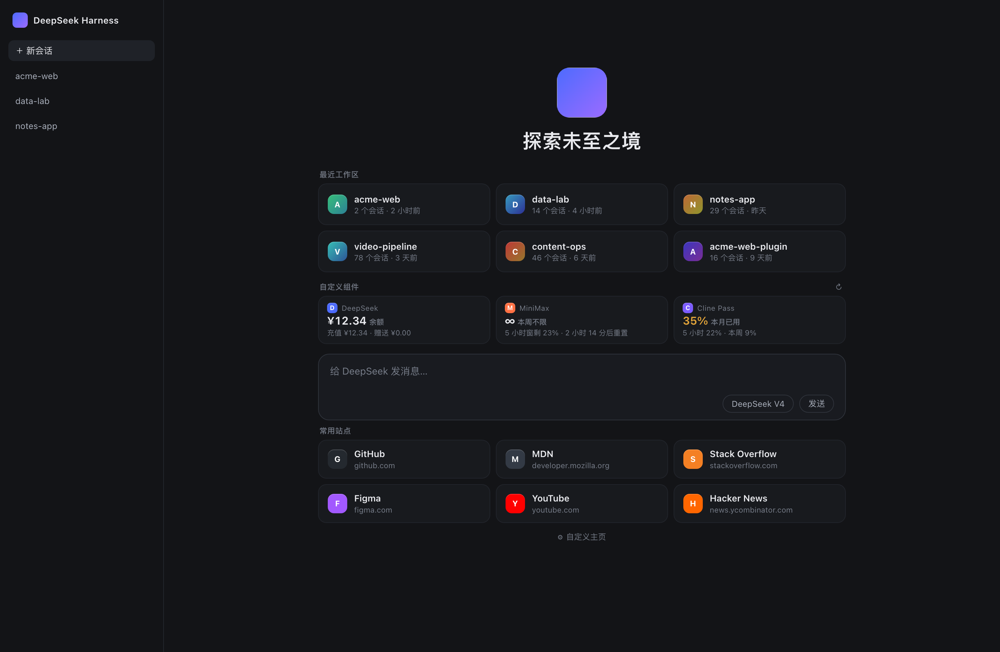

# dsh-my-newhome · DSH 自定义主页

给 DeepSeek Harness 桌面端换一整套首屏：配色、背景图、工作区卡片、常用入口、API 用量组件、自定义 Logo。
不改 DSH 本体，装/卸一个插件即可。MIT。



## 装上

桌面端 profile 由 Electron 独占管理，`dsh plugin --profile desktop add` 会被拒绝。两种装法：

- **插件管理器**（推荐）：设置 → 插件 → 选本地目录。
- **手动挂载**：在 `~/.dsh/profiles/desktop/package.json` 的 `dependencies` 加 `"dsh-my-newhome": "link:<仓库路径>"`，
  `dsh.profile.bundles` 末尾加 `"dsh-my-newhome"`，再建软链
  `ln -sfn <仓库路径> ~/.dsh/profiles/desktop/node_modules/dsh-my-newhome`。

装完**重启 DeepSeek Harness**；卸载删掉这三处再重启。

## 有什么

| 功能 | 位置 / 说明 |
|---|---|
| 配色 / 背景图 / 自定义 Logo | 主题 token、固定背景层、hero + 侧栏品牌位 |
| 最近工作区（3×2） | 输入框上方，**默认按「最近使用」排序**（最后一次对话时间，可切活跃度 / 会话数）；标题行右侧 `↻` 立即重读，每次回到首页也会自动重读一次 |
| 常用入口（3×2） | 同上，自动抓本机 Chrome 常访问站点 + 自定义 JSON 入口 |
| 自定义组件（最多 4 个） | 同上，标题行带 `↻`，点卡片本身也会刷新整行 |
| 设置面板 | 卡片下方 **⚙ 自定义主页**，所有选项都在里面 |

卡片只在首页（新会话）出现，打开历史对话自动隐藏；宽度跟随输入框实测宽度，换窗口也严丝合缝。

> 0.4.0 起默认排序从「活跃度加权」改为「最近使用」（按每个工作区最后一次对话时间）。旧配置会自动迁移一次；
> 想恢复旧行为，在设置面板里切回「活跃度」。取数时机：每次打开页面 / 回到窗口时自动重读一次，
> 标题行右侧 `↻` 可随时手动重读。

> 0.5.0 起，Cline Pass / OpenCode Go 的额度卡在「本月 XX%」后面直接标出本月重置日（如 `11/21`），
> 不用等悬停提示；卡片够宽时自动补上「重置」二字。MiniMax 的接口没有本月窗口，所以那张卡没有日期。

## 组件行（API 用量）

数据 60 秒缓存、默认 5 分钟轮询（1–60 可调）；取数失败显示 `—` 和原因，不影响其它卡片。

| 供应商 | 显示 | 来源 |
|---|---|---|
| DeepSeek | 余额 | 官方余额接口 |
| MiniMax | 大字 5 小时已用 %，小字本周已用 %（本周不限显示「不限」） | coding-plan 配额接口（只上报 5 小时 + 本周两个窗口，没有本月额度） |
| Cline Pass | 大字 5 小时已用 %，小字本周 / 本月已用 %，本月后跟重置日（如 `11/21`） | 订阅额度接口，悬停看各窗倒计时与本机 token 累计 |
| OpenCode Go | 与 Cline Pass 同款；`rate-limited` 时整卡转红并提示 Extra Usage | Go 订阅用量接口，悬停看各窗倒计时与本机 token 累计 |
| 其它 | 本机 token 累计 | `session_projcache` 投影统计 |

三个额度组件口径统一：**大字 = 5 小时窗已用 %，小字 = 本周、本月已用 %**（同一顺序、同一方向）；
颜色跟**最满的那个窗口**走（任一窗口 ≥80% 转黄，厂商明确报 `rate-limited` 才转红），大字仍然是 5 小时窗。
有本月窗口的卡（Cline Pass / OpenCode Go）把小字收成 `本周 38% · 本月 95% · 11/21`：紧跟在「本月」后面的
日期就是本月窗口的重置日，不用等悬停。卡片够宽（三张一排或窗口更宽）时补上「重置」二字，四张挤一排时只留日期。
精确到分钟的倒计时仍在悬停提示里。MiniMax 的 coding plan 接口只给 5 小时和本周两个窗口，没有本月额度，
所以那一张没有日期，不是漏了。

key 从 `$DSH_HOME/.credentials.yaml` 读，永不下发浏览器。加供应商：`lib/index.js` 的 `PROVIDER_DEFS`
加一条，再在 `lib/client.js` 的 `WIDGET_PROVIDERS` 加下拉项即可。

## 数据

```
$DSH_HOME/dsh-my-newhome/
  config.json          # 配色、透明度、排序策略、入口与组件列表
  background.<ext>     # 背景原图
  logo.<ext>           # 自定义 Logo
```

图片走插件自己的路由 `/dsh-my-newhome/asset`（带 ETag，只监听回环 + 同源校验），不写进 `cordis.patch.yml`。

## 开发

```bash
node test/host.test.mjs      # 宿主半边 106 条断言
node test/client.test.mjs    # 浏览器半边 31 条断言（排序契约 / 重置日格式）
```

`preview.html` 是静态预览页。布局方向的自由网格原型在
[`docs/prototype/`](docs/prototype/README.md)：双击 `docs/prototype/index.html` 即可体验
24 栏 1×1 网格、右侧组件抽屉、可开合 DSH 侧栏与深浅色切换。

组件生态（发行 / 开发 / 分享 / 数据边界）的设计见
[`docs/widget-distribution.md`](docs/widget-distribution.md)；其中「最小标准封装的 JS」已做成可运行
PoC：[`docs/prototype/sandbox-demo/`](docs/prototype/sandbox-demo/README.md)（沙箱 + 权限桥 +
越权探针实测），起本地服务即可体验。

插件展示元数据按官方
[插件显示约定](https://github.com/deepseek-ai/DeepSeek-Harness/blob/master/docs/cookbook/adding-a-package.md#plugin-display-metadata)
放在 `locale/en.json`、`locale/zh.json` 和 `icon.svg`，Plugins 页显示「Custom homepage / 自定义主页」。

## 边界

- Safari 历史受 macOS TCC 保护，需要「完全磁盘访问」；Chrome 可直接读。
- 侧栏 Logo 槽位需要 0.2.1+ 桌面运行时，旧版只替换首屏 Logo。
- DSH 内部槽位没有版本兼容承诺，接口缺失时静默降级。
