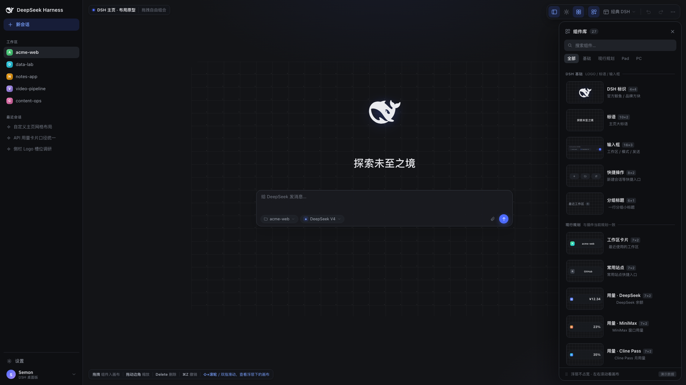
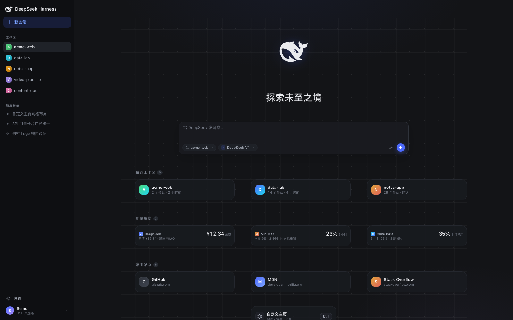
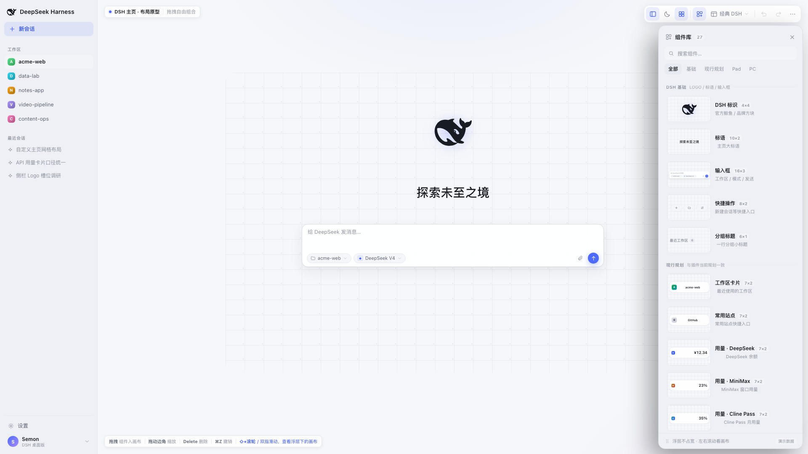
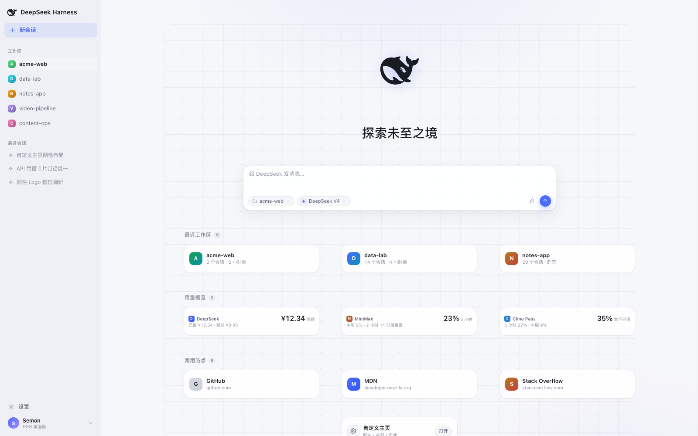
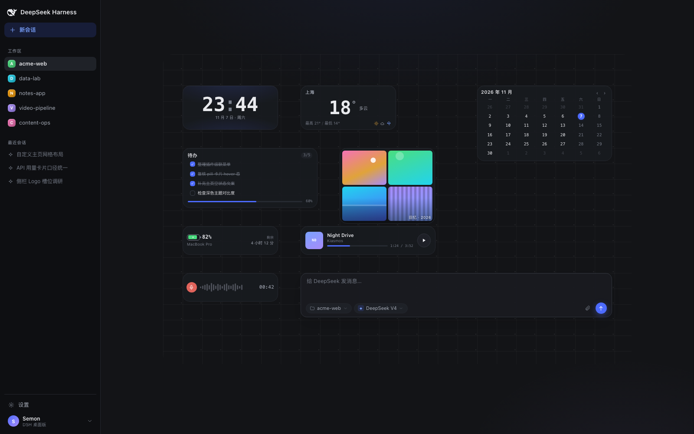
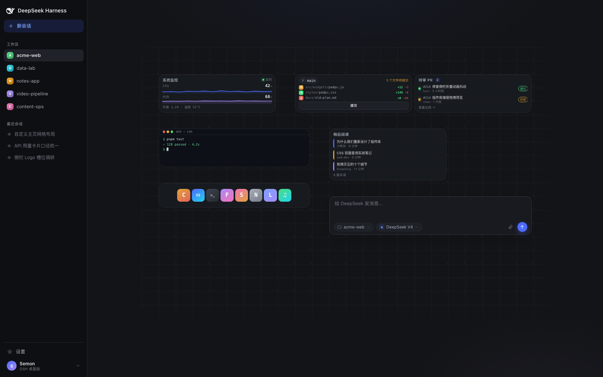
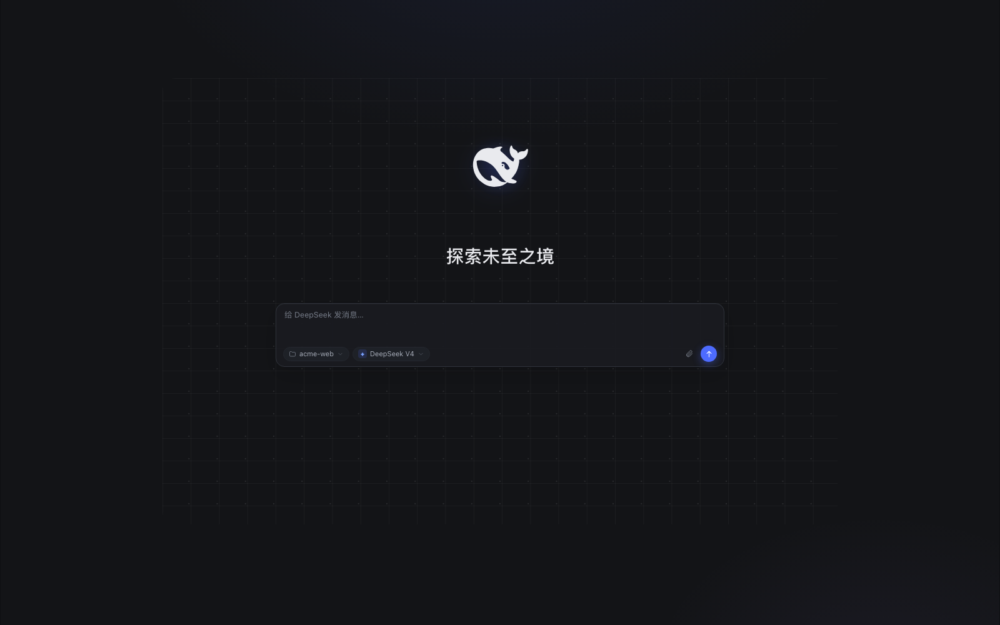
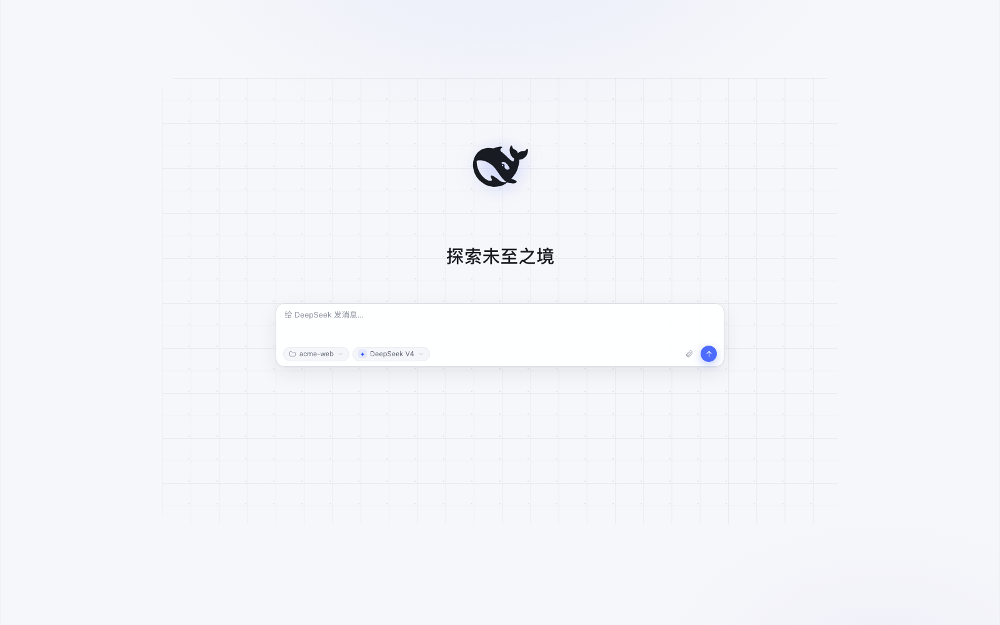

# DSH 自定义主页 · 布局原型（static prototype）

把 DeepSeek Harness 的新会话主页从「固定卡片叠层」改成「1×1 自由网格」的交互原型：
画布按 24 栏细网格铺开，右侧抽屉里的任意组件都能拖进画布、移动、缩放、删除，拼出完全
自定义的首页；过程中可以随时开关模拟的 DSH 左侧栏、切换深色 / 浅色，看看布局在真实
窗口尺寸下是否成立。右侧的组件抽屉是**编辑器浮层**，不参与画布布局，也不触发响应式。

纯静态：**没有构建、没有依赖、没有网络请求**，双击 `index.html` 就能跑。
建议用 Chrome / Edge / Safari 桌面端，窗口宽度 ≥ 1280。



---

## 打开

```bash
# 方式一：直接打开
open docs/prototype/index.html

# 方式二：起一个静态服务器（推荐，localStorage 行为更稳定）
cd docs/prototype && python3 -m http.server 8080
# → http://127.0.0.1:8080
```

file:// 下也能正常使用；如果浏览器限制 `localStorage`，自动保存会静默失效，其它功能不受影响。

---

## 一分钟上手

1. 看右侧「组件库」，把任意组件**拖进**画布；也可以直接**点击**组件，自动放到视口中间。
2. 点选画布里的组件：出现 8 个缩放手柄和底部属性条。拖动组件的非交互区域可移动，拖动边角
   或边线可缩放，位置和尺寸都吸附 1×1 网格，重叠会自动找最近的空位。
3. 点右上角按钮开关 **DSH 侧栏**、**组件抽屉**、**网格**、**深色/浅色**；**左侧栏开合**才
   触发画布宽度响应（组件横向变宽/变窄，垂直高度与位置不动）。**右侧组件抽屉是浮层**，
   不参与画布宽度计算；抽屉盖住的部分用触控板左右滚动 / Shift+滚轮查看即可。
4. 点「布局」切换预设：经典 DSH / 现行规划 / Pad 工作台 / PC 工作台 / 空白画布。
5. 输入框组件里可以切工作区、切模式；选中它后拖动底部「宽度」滑杆（或直接拖边框）调整宽度。

### 快捷键

| 操作 | 快捷键 |
|---|---|
| 撤销 / 重做 | `⌘Z` / `⇧⌘Z`（Windows：`Ctrl`） |
| 复制选中组件 | `⌘D` / `Ctrl+D` |
| 删除选中组件 | `Delete` / `Backspace` |
| 方向键微调位置 | `← ↑ → ↓` |
| 取消选中 / 关菜单 | `Esc` |
| 显示 / 隐藏 DSH 侧栏 | `S` |
| 深色 / 浅色 | `T` |
| 显示 / 隐藏网格 | `G` |
| 打开 / 收起组件库 | `D` |
| 查看浮层下的画布 | 双指左右滑动 / `Shift+滚轮` |
| 导出布局 JSON | `⌘S` / `Ctrl+S` |

---

## 组件库（27 个 demo）

| 分类 | 组件 | 说明 |
|---|---|---|
| **DSH 基础** | DSH 标识 | 官方单色鲸鱼（重复添加会轮换品牌方块 / 渐变色块） |
| | 标语 | 「探索未至之境」 |
| | 输入框 | 工作区选择 + 模式选择 + 可调宽度 |
| | 快捷操作 | 新建会话 / 打开工作区 / 自定义主页 |
| | 分组标题 | 最近工作区 / 用量概览 / 常用站点（按变体轮换） |
| **现行规划** | 工作区卡片、常用站点 | 插件当前已实现的「最近工作区 / 常用入口」形态 |
| | 用量 · DeepSeek / MiniMax / Cline Pass / OpenCode Go | 插件当前规划里的配额组件 |
| | 自定义主页入口 | ⚙ 设置卡片 |
| | 今日速记 | 可勾选便签 |
| **Pad 组件** | 时钟、天气、日历、待办、音乐、设备状态、相册、语音备忘 | 大圆角、大点击目标、信息更少 |
| **PC 组件** | 系统监控、Git 状态、GitHub PR、终端、稍后阅读、应用坞 | 高信息密度、等宽数字、桌面工作台气质 |

所有数据都是写死的演示数据（工作区名 / 站点 / 配额 / 会话数等），不连本机、不请求外部接口。
组件的深色 / 浅色、最小 / 最大尺寸都做过适配；窗口或左侧栏变化时，组件内容用容器查询自适应。

---

## 布局预设

| 预设 | 内容 |
|---|---|
| 经典 DSH | 鲸鱼 Logo + 标语 + 输入框（默认） |
| 现行规划 | Logo / 标语 / 输入框 + 工作区卡 ×3 + 用量卡 ×3 + 常用站点 ×3 + 设置入口 |
| Pad 工作台 | 时钟 / 天气 / 日历 / 待办 / 相册 / 电量 / 音乐 / 语音 + 输入框 |
| PC 工作台 | 系统监控 / Git / PR / 终端 / 稍后阅读 / 应用坞 + 输入框 |
| 空白画布 | 从零开始 |



---

## 状态与截图参数

原型会把布局、主题、侧栏/抽屉状态自动存进 `localStorage`（键 `dsh-home-prototype-v1`）。
需要重置时点右上角「⋯ → 恢复经典 DSH 布局」。

URL 支持一组参数，方便直接打开某个状态或做无头截图：

| 参数 | 取值 | 说明 |
|---|---|---|
| `preset` | `classic` `plan` `pad` `pc` `blank` | 强制加载某个预设（同时忽略本地存档） |
| `theme` | `dark` `light` | 深 / 浅色 |
| `sidebar` | `open` `closed` | 模拟 DSH 侧栏 |
| `drawer` | `open` `closed` | 右侧组件抽屉 |
| `grid` | `on` `off` | 网格显隐 |
| `capture` | `1` | 隐藏编辑器 chrome（工具栏 / 徽标 / 快捷键条 / 选中框），用于出图 |

例：

```text
index.html?preset=plan&drawer=closed&theme=light
index.html?preset=classic&sidebar=closed&drawer=closed&capture=1
```

浏览器控制台里还有一个只读调试入口 `window.__DSH_PROTOTYPE__`（`getState()` / `applyPreset()` /
`addWidget()` / `setTheme()` 等），方便做自动化截图与回归。

---

## 文件结构

```text
docs/prototype/
  index.html              # 页面骨架 + SVG 图标 sprite + 模拟 DSH 侧栏
  styles/
    base.css              # token、外壳、24 栏画布（列宽响应/行高固定）、抽屉、工具栏
    composer.css          # 输入框组件样式
    widgets-plan.css      # DSH 基础 + 现行规划 12 个组件
    widgets-padpc.css     # Pad 8 个 + PC 6 个组件
  js/
    app.js                # 网格引擎、拖放/缩放/避让、历史、预设、持久化
    composer.js           # 输入框组件（工作区/模式下拉、宽度）
    widgets-plan.js       # base+plan 组件定义（window.DSH_WIDGETS_BASE_PLAN）
    widgets-padpc.js      # pad+pc 组件定义（window.DSH_WIDGETS_PAD_PC）
  assets/whale.svg        # DSH 官方鲸鱼 logo（取自 DSH favicon）
  screenshots/            # 出图
  sandbox-demo/           # 单文件组件的沙箱运行时 PoC（iframe + 权限桥 + 越权探针）
  CONTRACT.md             # 组件作者契约（渲染/尺寸/交互约定）
  LAYOUT-BEHAVIOR.md      # DSH 左右栏开合的真实布局行为与原型对齐规则
  DESIGN-NOTES.md         # 真实 DSH 0.2.2 的尺寸 / token 考据与校准建议
  README.md
```

> **组件怎么发行、怎么安全分享**：`docs/widget-distribution.md` 给出方案；其中「一个标准封装的
> `.js` = 一个组件」已在 [`sandbox-demo/`](sandbox-demo/README.md) 做成可运行 PoC
> （`iframe sandbox="allow-scripts"` + CSP + 权限经纪人，含攻击探针实测 7/7 被拦）。
> 起服务：`cd docs/prototype/sandbox-demo && python3 -m http.server 8099`。

---

## 设计说明（给实现者的几句话）

- **网格**：24 栏；**列宽响应、行高固定**——`cellW = (canvasWidth − 6×23) / 24`，
  `rowH = 30px`，画布最大宽 1080px。**只有左侧 DSH 侧栏开合 / 窗口宽度变化会触发列宽重算**；
  右侧组件抽屉是编辑器浮层，绝对定位，不占布局宽度。垂直位置和高度逐像素不变，这与真实
  DSH 的列轨道规则一致，调研、证据与浮层取舍见 [LAYOUT-BEHAVIOR.md](LAYOUT-BEHAVIOR.md)。
  组件位置与尺寸都用「格」保存，所以窗口变宽变窄不会破坏布局。
- **右侧抽屉浮层**：抽屉打开时不推挤画布，画布在右缘多出一段可滚动余量；触控板左右滑动
  或 `Shift + 滚轮` 可把被抽屉盖住的区域移到可⻅范围。抽屉关闭后滚动位置归零。
- **抽屉是编辑器 chrome，不是 DSH 的一部分**：它负责给画布投喂组件；模拟的 DSH 侧栏才是
  用来观察「布局在侧栏开 / 合时是否成立」的对象。
- **主题 token 与插件当前视觉一致**（`#131417` / `#191b20` / `#4d6bfe` …），方便和
  `preview.html`、插件实机截图对照；模拟侧栏按插件截图取景为 232px。真实 DSH 0.2.2 的官方
  token 与尺寸有差异（默认侧栏 280px、中性灰、强调蓝 `#7aaaff` / `#4176e6`、鲸鱼 34px 等），
  完整考据与 11 条校准建议见 [DESIGN-NOTES.md](DESIGN-NOTES.md)。
- **Logo**：默认是 DSH 官方单色鲸鱼（`assets/whale.svg`，取自 DSH 0.2.2 favicon）；重复添加
  组件会轮换「品牌渐变方块 + 白鲸」「纯渐变方块」两种插件历史视觉。
- **输入框**：工作区与模式选择都收在卡片内底行，符合这次「两者放在一起、整体宽度可调」的
  目标；与官方 DSH「工作区 chip 在卡外独立一行」不同，这是有意做的产品差异。
- **组件契约**：`CONTRACT.md` 定义了 `render(ctx)` / `mount(root, ctx)`、尺寸字段、token、
  `data-nodrag` 与交互边界，组件库作者可以按契约继续加组件。

---

## 边界与后续

- 纯展示原型：没有真实会话、工作区、配额接口；`⌘S` 导出的是布局 JSON，不含数据。
- 拖拽目前只支持单组件选择，没有框选 / 多选 / z-order / 图层；碰撞策略是「找最近空位」，
  不是自动重排。
- 右侧组件抽屉始终是浮层；视口 < 1080px 时左侧 DSH 侧栏也改为覆盖式，< 760px 时简化编辑器 chrome；原型主要面向桌面。
- 文件都在 `docs/` 下，不影响插件 `lib/`、测试和现有 `preview.html`。

---

## 截图

> 编辑器两张为 1920×1080，其余为 1600×1000。

| | |
|---|---|
|  |  |
| 深色 · 侧栏 + 抽屉打开 | 浅色 · 侧栏 + 抽屉打开 |
|  |  |
| 现行规划 · 深色 | 现行规划 · 浅色 |
|  |  |
| Pad 工作台 | PC 工作台 |
|  |  |
| 侧栏关闭 · 只有宽度变化，垂直不变 | 浅色 · 经典首页 |
