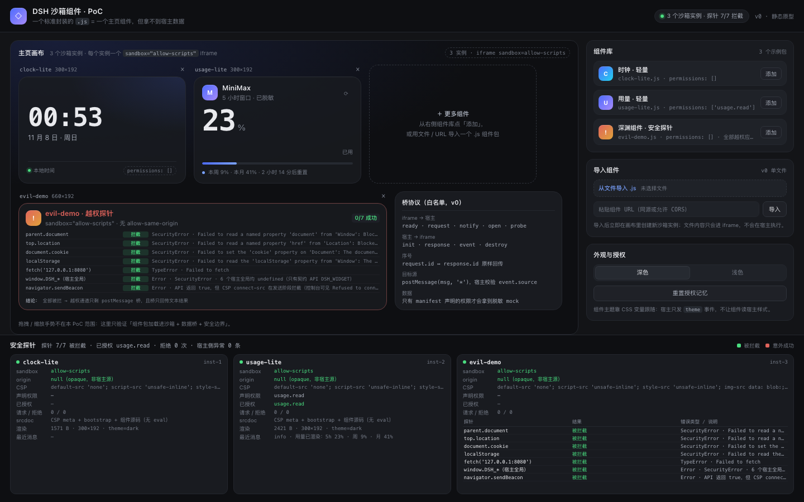

# DSH 沙箱组件 PoC

把「一个主页组件」做成**单个标准封装的 `.js` 文件**，由宿主加载进
`<iframe sandbox="allow-scripts" referrerpolicy="no-referrer">` 里运行，通过
`srcdoc` 注入 bootstrap + 组件源码（**不 eval**），再用 postMessage 桥提供
主题 / 尺寸 / 已授权数据。

结论：**组件拿不到宿主数据，也拿不到宿主 DOM / Cookie / localStorage / 网络**——
这不是靠组件作者自觉，而是 opaque origin + sandbox + CSP 三层浏览器强制。



> 1440×900，Chrome 156 无头实测。左侧是 3 个沙箱实例（时钟 / 用量 / 越权探针），
> 右侧是组件库与导入，底部是安全探针面板（sandbox 属性、CSP、授权、逐项越界结果）。

---

## 1. 起服务

```bash
cd docs/prototype/sandbox-demo
python3 -m http.server 8099
# 打开 http://127.0.0.1:8099/
```

必须用 http:// 打开（组件包是 `fetch()` 加载的；`file://` 下见第 8 节限制）。
纯静态：**无构建、无 npm 依赖、无外部网络请求**，组件示例也不请求外网。
建议窗口 ≥ 1280×800；页面按 1440×900 设计，1440 以下内容会按设计缩放/裁剪。

### URL 参数（用于演示与无头截图）

| 参数 | 取值 | 说明 |
|---|---|---|
| `theme` | `dark` / `light` | 强制主题（优先于 localStorage） |
| `auto` | `allow` / `deny` | 跳过授权确认条（**只对本次加载生效，不写 localStorage**；已存的选择仍优先）。无头截图用它，免得卡在确认条上 |

```text
http://127.0.0.1:8099/?auto=allow&theme=dark     # 全部数据可见（截图用）
http://127.0.0.1:8099/?theme=light               # 浅色 + 首次授权确认条
http://127.0.0.1:8099/?auto=deny                 # 演示「拒绝」路径
```

---

## 2. 目录结构

```text
docs/prototype/sandbox-demo/
  index.html              宿主页面；含两个内联资源：
                            #widget-css       主题 token + 公共组件类（宿主与 iframe 共用同一份）
                            #iframe-bootstrap iframe 沙箱运行时源码（type=text/plain，宿主不执行，只拼进 srcdoc）
  sandbox.css             宿主 chrome 样式（工具栏 / 画布 / 组件库 / 探针面板 / 确认条）
  host.js                 加载器 + 桥协议实现 + 权限确认 + 探针面板 + 导入 + 主题
  widgets/
    clock-lite.js         零权限本地时钟（render + mount + setInterval + cleanup）
    usage-lite.js         申请 usage.read，大字百分比 + 周/月 + 手动重新请求
    evil-demo.js          故意越权探针（7 项），全部应失败，结果回传宿主 DOM
  tools/cdp-verify.mjs    可选：确定性取证脚本（Node 内置能力，零依赖，不是 demo 运行所需）
  screenshot.png          深色 · 数据全开（auto=allow）
  screenshot-light.png    浅色
  screenshot-prompt.png   首次授权确认条 + 组件「等待授权」态
  README.md
```

只写本目录：**没有修改** `docs/prototype/` 的其它文件、`lib/`、`package.json`、根 `README.md`。

---

## 3. 组件包规格（v0，可直接复用的 define 契约）

**一个组件包 = 单个 `.js` 文件**，顶层调用 `DSH_WIDGET.define({...})`。写法沿用
`docs/prototype/CONTRACT.md` 的作者心智模型（`render(ctx)` 返回 HTML 字符串、
`mount(root, ctx)` 返回 cleanup、只用主题 token），只是运行位置从主文档变成 iframe。

```js
DSH_WIDGET.define({
  id: 'clock-lite',                 // kebab-case，必填；一个文件只允许 define 一次
  name: '时钟 · 轻量',               // 组件库显示名
  version: '1.0.0',
  author: 'demo',
  description: '零权限的本地时钟，跟随宿主主题。',
  permissions: [],                  // 默认 []；可选 'time.now' | 'usage.read'
                                    //      | 'workspaces.read' | 'links.read'
  grid: { w: 5, h: 3, minW: 4, minH: 3, maxW: 10, maxH: 6 },

  // 必须返回 HTML 字符串；可以带 <style>（单文件包没有独立 CSS 文件）
  render(ctx) {
    return '<style>…</style><div class="w w-card">' + hhmm(ctx.now) + '</div>';
  },

  // 可选；返回 cleanup 函数。宿主 destroy 时调用（卸载实例会触发）
  mount(root, ctx) {
    const timer = setInterval(paint, 1000);
    const off = ctx.on('data', update);          // 'data' | 'theme' | 'resize'
    return () => { clearInterval(timer); off(); };
  }
});
```

### ctx（两个方向都只传这些）

| 字段 | 类型 | 说明 |
|---|---|---|
| `theme` | `'dark' \| 'light'` | 主题。仅作辅助判断；颜色请用 token |
| `size` | `{ w, h, cols, rows }` | iframe 的像素尺寸；`cols/rows` 是按 48×30 px 的近似格数 |
| `locale` | `string` | 目前固定 `'zh-CN'` |
| `instanceId` | `string` | 实例 id（同一个组件可以多实例，别用全局 id） |
| `now` | `Date` | init 时刻的 `Date` 副本 |
| `data` | `object` | **只含已授权资源**，按资源名取：`ctx.data['usage.read']` |
| `on(event, cb)` | `(string, fn) => unsub` | `'data'`（后有 `{resource, data}`）/ `'theme'`（`{theme}`）/ `'resize'`（`{size}`） |

### 组件可用的全局 API（v0 增量，规格未定义，见第 9 节）

| API | 说明 |
|---|---|
| `DSH_WIDGET.request(resource, params?)` | 返回 Promise。宿主按 `manifest.permissions` 校验；拒绝时 reject 的 `Error.code` ∈ `E_PERM_DENIED` / `E_PERM_NOT_DECLARED` / `E_UNKNOWN_RESOURCE` / `E_TIMEOUT` |
| `DSH_WIDGET.notify(level, text)` | 单向通知宿主（`info` / `warn` / `error`），宿主用 textContent 渲染、只保留最近 6 条 |
| `DSH_WIDGET.open(url)` | 请求宿主打开外链；宿主二次确认后才 `window.open`，只允许 `http(s)` |
| `DSH_WIDGET.reportProbe(items)` | 安全探针专用：把 `[{name, ok, detail}]` 回传宿主展示 |

约束（iframe 里同样适用）：组件根节点用 `.w` 铺满 `100%×100%`；只用 token 变量
（iframe 内已注入同一套 `#widget-css`）；样式类名以 `.w-<id>` 前缀避免撞名；不要
`position:fixed` / `100vw/100vh`；`mount` 里的定时器必须 cleanup。

---

## 4. 宿主如何加载（srcdoc 字符串拼接，不 eval）

1. 收到组件源码文本（仓库内 `fetch('widgets/x.js')`、文件导入、URL 导入）。
2. 拼出一个完整 HTML 文档字符串：

```html
<!doctype html><html data-theme="dark"><head>
<meta charset="utf-8">
<meta http-equiv="Content-Security-Policy" content="default-src 'none'; script-src 'unsafe-inline';
  style-src 'unsafe-inline'; img-src data: blob:; connect-src 'none'; font-src data:;
  form-action 'none'; base-uri 'none'">
<style>/* iframe 基础样式 */</style>
<style>/* #widget-css：token + 公共组件类 */</style>
</head><body><div id="dsh-root"></div>
<script>/* bootstrap：提供 DSH_WIDGET + postMessage 桥 + 生命周期 + 错误捕获 */</script>
<script>/* 转义后的组件源码 */</script>
</body></html>
```

3. `iframe.setAttribute('sandbox', 'allow-scripts')`、
   `iframe.setAttribute('referrerpolicy', 'no-referrer')`、`iframe.srcdoc = html`，
   挂到画布上。**宿主从不执行组件代码**，也从未调用 `eval` / `new Function`。
4. iframe 内 bootstrap 收到 `ready` 后宿主回 `init`；`destroy` 时运行 cleanup 再摘掉 iframe。

### 拼接时踩过的坑

| 坑 | 处理 |
|---|---|
| 组件源码里的 `</script>` 会提前结束宿主拼出来的 `<script>` | 替换成 `<\/script`（在 JS 字符串/正则里语义相同，HTML 解析器不再识别） |
| 组件源码里的 `<!--` 会让 HTML 解析器进入 script-data-escaped 状态 | 替换成 `<\!--` |
| 反引号 / `${}` / 模板字符串 | **不需要转义**：源码是作为「值」拼进去的，不会再被模板解析 |
| 组件源码里 `</style>` / 非字符串上下文里的上述序列 | 未做通用转义（组件是可信来源时不需要；不可信来源应改成「只允许纯 render 函数」或独立编译，见第 8 节） |
| 主题 | iframe 是独立文档，读不到宿主 CSS 变量，所以把 `#widget-css` 整段注入 iframe；切主题只发 `theme` 事件 + 改 `data-theme`，不重渲染 |
| CSP meta 位置 | 必须在 `<head>`、脚本之前，否则 inline 脚本会被拦 |
| `default-src 'none'` 下组件图片 | 已显式放开 `img-src data: blob:`，组件只能用 data URI 内联图 |

---

## 5. 宿主桥协议表（v0）

宿主只接受 `event.source === iframe.contentWindow` 的消息；其他来源一律忽略。
请求带序号，响应原样回传同一个 `id`。

### iframe → 宿主

| 消息 | 字段 | 说明 | 宿主动作 |
|---|---|---|---|
| `ready` | `widget: {id,name,version,author,description,permissions,grid}` 或 `error` | 组件已 `define`；80ms 内没 define 会上报 `E_NO_DEFINE` | 记录 manifest，回 `init` |
| `request` | `id, resource, params` | 请求一个资源 | 按 manifest 权限校验 → 放行返回脱敏 mock，或拒绝 |
| `notify` | `level, text` | 单向通知 | textContent 渲染进探针面板 |
| `open` | `url` | 请求打开外链 | 二次确认后 `window.open`；非 http(s) 直接拒绝 |
| `probe` | `items: [{name, ok, detail}]` | 越权探针结果（v0 增量） | 渲染成宿主 DOM 表格（可 dump-dom 取证） |
| `error` | `message, source, line` | bootstrap 捕获的 `error` / `unhandledrejection` | 记录到实例错误与状态栏 |
| `destroyed` | — | destroy 后 ack | 忽略 |

### 宿主 → iframe

| 消息 | 字段 | 说明 |
|---|---|---|
| `init` | `seq, ctx:{theme,size,locale,instanceId,now,data}` | 收到 ready 后下发；`data` 只含**已授权**资源 |
| `response` | `id, ok, data` / `id, ok:false, error:{code,message}` | 与 request 的 id 一一对应 |
| `event` | `event:'data'|'theme'|'resize', payload` | 授权成功推 `{resource,data}`；切主题推 `{theme}`；尺寸变化推 `{size}` |
| `destroy` | — | 运行组件 cleanup，然后宿主摘掉 iframe |

### 权限与资源

| 资源（= 权限 id） | 确认条文案 | 返回的脱敏数据 |
|---|---|---|
| `usage.read` | 用量与配额 | `[{provider, kind:'balance'|'quota', amount?, currency?, percent5h?, percentWeek?, percentMonth?, resetAt?, tone?}]`，**无 key / 无账号** |
| `workspaces.read` | 最近工作区 | `[{name, sessions, lastUsedAt}]`，**无本地路径** |
| `links.read` | 常用站点 | `[{title, domain}]` |
| `time.now` | 系统时间 | `{iso}` |

授权规则：manifest 未声明 → `E_PERM_NOT_DECLARED`（不弹条）；首次遇到 → 弹「允许 / 拒绝」
并写入 `localStorage`（键 `dsh-sandbox-demo-perms-v1`）；已存选择优先于 `?auto=`；
`request` 与 init 时都会走到同一套校验。

---

## 6. 安全边界表（实测，Chrome 156，2026-11-08）

evil-demo 在 iframe 里逐项尝试，7/7 全部被拦；下面「实测结果」列是它回传到宿主 DOM 的
真实错误文案（可在 `screenshot.png` 底部与 `--dump-dom` 产物里核对）。

| 越权尝试 | 机制 | 实测结果 |
|---|---|---|
| `parent.document` | opaque origin 跨源 | ❌ `SecurityError · Failed to read a named property 'document' from 'Window': Blocked a frame with origin "null" from accessing a cross-origin frame` |
| `top.location.href` 读 / 写 | 跨源 Location | ❌ `SecurityError · Failed to read a named property 'href' from 'Location': Blocked a frame …` |
| `document.cookie` 读 / 写 | sandbox 无 `allow-same-origin` | ❌ `SecurityError · Failed to set the 'cookie' property on 'Document': The document is sandboxed and lacks the 'allow-same-origin' flag` |
| `localStorage` / `sessionStorage` | 同上 | ❌ `SecurityError · Failed to read the 'localStorage' property from 'Window': The document is sandboxed and lacks the 'allow-same-origin' flag` |
| 外网 `fetch()` | CSP `connect-src 'none'` | ❌ `TypeError · Failed to fetch`；控制台：`Refused to connect because it violates the document's Content Security Policy`（指向 `connect-src 'none'`） |
| `navigator.sendBeacon()` | CSP 发送阶段拦截 | ⚠️ API 返回 `true`，但请求被 CSP 拦下（控制台同样有 `Refused to connect`）——所以判「被拦截」，不能只看返回值 |
| 读宿主全局 `window.DSH_*` | 独立 window，只有 bootstrap 注入的契约 API | ❌ `DSH_HOST / DSH_SESSION / DSH_USAGE / DSH_TOKEN / DSH_WORKSPACE / __DSH__` 全部 `undefined`；只有 `DSH_WIDGET`（契约 API，无宿主数据） |
| 宿主 DOM 文本 / 样式 / 输入框 | 跨源文档 | ❌ 同 `parent.document` |
| 读宿主 localStorage | 跨源 | ❌ 只能访问自己 opaque origin 的存储（实际不可用） |
| `postMessage` 向宿主发消息 | 桥协议 | ✅ **唯一允许的出口**：宿主校验 `event.source`，且只处理白名单 `t` 值 |
| 打开外链 | 宿主二次确认 | ✅ 只能发 `open` 请求；非 `http(s)` 被拒绝（实测 `javascript:` 被拦，组件收到 `warn: 只能打开 http(s) 链接`） |
| `alert()` / `confirm()` / 弹窗刷屏 | sandbox 未给 `allow-modals` | ⚠️ 未单独实测（理论应由浏览器阻止） |
| WebSocket / `` 外链 | CSP `connect-src` / `default-src 'none'` | ⚠️ 未单独实测（fetch 与 beacon 已证明 CSP 生效，理论上同源限制覆盖） |
| 恶意组件的 CPU / 内存消耗、伪造 notify 文案、授权钓鱼 | 浏览器沙箱之外的产品风险 | ⚠️ **本 PoC 未防护**：宿主用 textContent 渲染通知（防注入），但没有 CPU 配额 / 频率限制 / 权限审批防钓鱼设计 |
| 组件包里塞 `</script>` / `<!--` 破坏 srcdoc | 字符串拼接 | ✅ 已转义（第 4 节）；但**非字符串上下文**的同类序列未做通用防御 |

探针面板同时列出每个实例的 `sandbox="allow-scripts"`、完整 CSP 串、
`origin=null（opaque，非宿主源）`、已声明 / 已授权权限、请求与拒绝次数、最近消息、
以及组件 render 出的 DOM 体积与尺寸（`渲染 1571 B · 300×192 · theme=dark`），
作为「组件确实在 iframe 里跑起来了」的旁证。

---

## 7. 实测记录

### 已验证（Chrome 156.0.8078.81 / macOS / 2026-11-08）

全部通过 CDP **真实等待 3.5s** 后取证（`tools/cdp-verify.mjs`），不是只靠「页面看起来对」：

- 3 个 iframe 全部 `origin=null`、`sandbox="allow-scripts"`、srcdoc 内含 CSP meta，
  且 iframe 内部 `--tx-1=#e9eaee`（token 注入成功）、组件根节点尺寸 = 300×192 / 660×192。
- `probeStats = { total: 7, blocked: 7, failed: 0 }`；探针表逐行状态 + 错误类型见第 6 节。
- usage-lite 拿到 `usage.read` → 渲染 `23%`，周 `9%`、月 `41%`、`2 小时 14 分后重置`；
  宿主侧收到 notify：`用量已渲染：5h 23% · 周 9% · 月 41%`（在宿主 DOM 里，可 dump-dom）。
- clock-lite 每秒更新，`permissions: []`；destroy 后 interval 随 iframe 一起消失。
- `hostErrors = []`、`consoleErrors = []`（favicon 404 用 `<link rel="icon" href="data:,">` 消掉）。
- 布局 1440×900 无溢出：画布 grid `450/450`、探针每列 `249/249`。
- 交互 E2E（18/18 通过）：首次请求弹确认条 → 允许 → 数据落地 + localStorage 记忆 →
  刷新不再弹 → URL 导入第 4 个实例 → 卸载回 3 个 → `?auto=deny` 时 denied=1 且无数据。
- `open` 桥：合法 URL 弹二次确认，取消后不打开；`javascript:` 被拒并给出 warn。

### 未验证（需真机复核）

- **DSH 内置 Chromium 152**：本 PoC 只在桌面 Chrome 156 无头下跑过。待真机确认：
  `srcdoc` + CSP meta 在 Electron / 自定义 scheme 下是否被宿主 CSP 收窄、
  `sandbox` 属性与 opaque origin 行为、postMessage 目标源、`file://` 下的表现。
- Safari / Firefox（未在 mac 以外的浏览器实测；`color-mix` / `:has` 等依赖较新内核）。
- 恶意组件的资源耗尽、`alert` 弹窗、WebSocket 出网、CSP 报告等安全项（见第 6 节「未实测」行）。

---

## 8. 已知限制（踩过的坑都在这）

1. **`file://` 下 `fetch()` 不可用** → 组件库加载失败（页面会提示「请用 http:// 起服务；
   file:// 下请改用「从文件导入」」）。文件导入用 `FileReader`，仍可用；
   `localStorage` 在部分浏览器 file:// 下也可能不可用，授权记忆将静默失效（不影响其它功能）。
2. **`--virtual-time-budget` 截图 / dump-dom 会抖**（本轮最值得记的坑）：
   sandboxed iframe 是 opaque origin，Chrome 默认把它隔离成 **OOPIF（独立渲染进程）**，
   宿主 ↔ iframe 的 postMessage 是跨进程 IPC；`--virtual-time-budget` 只快进虚拟时间，
   并不会等跨进程消息。预算耗尽就截图，于是偶发某个 iframe 空白 / 探针没进宿主 DOM
   （实测裸命令 3 次里 2 次缺内容，1 次完整）。两种稳定做法：
   - 加 `--disable-features=IsolateSandboxedIframes`（只影响进程隔离，**不改变**
     origin / sandbox / CSP 的拦截语义）；连测 2 次均完整，本仓库截图即由此产出；
   - 或改用 `tools/cdp-verify.mjs`：真实等待 3.5s 再 `Page.captureScreenshot` +
     `Runtime.evaluate` 抓宿主 DOM / `__DSH_SANDBOX_POC__.getState()`，并 auto-attach
     进 OOPIF 抓 iframe 内部 `innerText`。
   `--dump-dom` 同理：默认在 load 后立刻 dump，拿不到晚到消息；加同一个 flag 后可稳定抓到
   `<tr data-probe="parent.document">…` 与 `用量已渲染：5h 23% …`。
3. **画布是固定像素，不是 24 栏网格**：拖拽 / 缩放 / 避让 / z-order 都没做（不是本 PoC 目标）；
   `data-nodrag` 语义保留（组件内交互天然不会触发宿主拖动），但宿主这里没有拖拽可消费。
4. **单文件包没有独立 CSS**：组件样式必须写在 `render()` 返回的 `<style>` 里；
   每个实例的 srcdoc 都完整重复一份 bootstrap + token + 组件源码，体积随实例数线性增长
   （真实产品应改成共享 blob URL 或编译期打包）。
5. **权限模型很粗**：声明即弹一次确认 + localStorage 记忆；`?auto=` 仅供测试，不写记忆；
   已存选择优先于 `?auto=`。没有「仅本次允许」、没有按调用次数/参数过滤、没有撤回入口
   （只有「重置授权记忆」）。
6. **`sendBeacon` 返回 `true` 不代表发出**（CSP 在发送阶段拦），探针按「未送达=被拦」判定。
7. **字符串级转义只处理 `</script>` 与 `<!--`**：若组件源码把这两个序列写在字符串/正则
   之外的其他上下文，仍可能破坏 srcdoc。真实产品若接受第三方组件，应改为：组件只允许
   提交 `render/mount` 函数体（不拼 HTML），或在独立编译步骤里做 AST 级转义。
8. **iframe 内对话框**（`alert`/`confirm`）与 WebSocket 等未单独实测；理论上分别受
   sandbox 的 `allow-modals` 缺失与 CSP `connect-src 'none'` 限制（见第 6 节）。
9. **探针数字与文案是写死的模拟数据**：不连真实 DSH 会话 / 配额接口；`usage.resetAt`
   由宿主按「当前时间 + N 分钟」生成，所以「还剩多久」每次刷新都不同。
10. **授权确认条固定在视口底部**，会盖住探针面板最后一行（见 `screenshot-prompt.png`），
    是演示取舍，不是最终交互方案。

---

## 9. 规格之外的 v0 增量（与任务规格的差异，均未改动既有消息语义）

任务规格定义了消息类型与 `ctx`，但没有钉死下面几处，本实现补了最小约定：

1. **组件如何发起数据请求**：规格只在桥里定义了 `{t:'request'}`，没定义组件调用的 API。
   实现为 `DSH_WIDGET.request(resource, params)`（Promise），并保留「宿主 pre-seed
   `ctx.data`」的行为，兼容只读 `ctx.data` 的组件。
2. **探针结果回传宿主**：规格要求「把每项结果回传到宿主 DOM 展示」，但没有对应消息类型。
   新增 `{t:'probe', items:[{name, ok, detail}]}`，只用于演示取证，不进权限体系。
3. **init 与授权顺序**：规格是「收到 ready 后发送 init」。实测先授权再 init 会让组件首屏
   空白（要等确认条），所以改为 **init 先发（`data` 为空）→ 授权成功再推 `data` 事件**；
   协议顺序仍满足 `ready → init`，`request` 流程不变。
4. **`reportProbe` / `notify` / `open`** 是 iframe 侧对桥消息的封装，宿主侧消息格式与规格一致。

---

## 10. 自测命令

```bash
# 0) 起服务
cd docs/prototype/sandbox-demo && python3 -m http.server 8099

# 1) 确定性截图 + 取证（推荐；真实等待，不受 virtual-time 抖动影响）
node tools/cdp-verify.mjs \
  --url 'http://127.0.0.1:8099/?auto=allow&theme=dark' \
  --out /tmp/verify
# → /tmp/verify/{screenshot.png, host-dom.html, host-state.json, frames.json, summary.json, console.json}

# 2) 可选：CLI 截图 / dump-dom（务必带 --disable-features=IsolateSandboxedIframes）
"/Applications/Google Chrome.app/Contents/MacOS/Google Chrome" \
  --headless=new --no-sandbox --disable-crash-reporter \
  --user-data-dir=/tmp/dshw-$$ --disable-gpu --hide-scrollbars \
  --disable-features=IsolateSandboxedIframes \
  --virtual-time-budget=4000 --window-size=1440,900 \
  --screenshot=/tmp/sandbox-demo.png \
  "http://127.0.0.1:8099/?auto=allow&theme=dark"

# 3) 取证：宿主 DOM 里应能读到探针表与 usage 渲染结果
... --dump-dom "http://127.0.0.1:8099/?auto=allow&theme=dark" > /tmp/dump.html
grep -o 'data-probe="[^"]*"' /tmp/dump.html      # 7 行，全部 res-ok（被拦截）
grep -o '用量已渲染：[^<"]*' /tmp/dump.html      # 5h 23% · 周 9% · 月 41%
```

`tools/cdp-verify.mjs` 只依赖 Node 内置能力（`child_process` / `WebSocket` / `fetch`），
**不是 demo 运行所需**，浏览器里打开页面不需要 Node。
